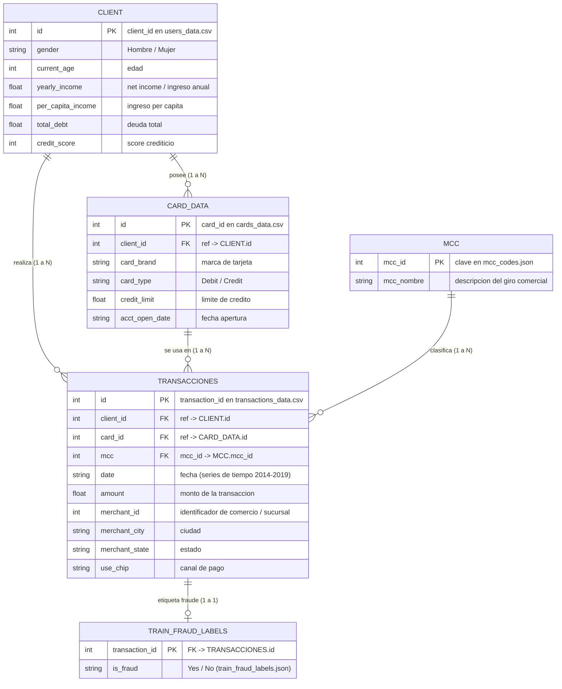
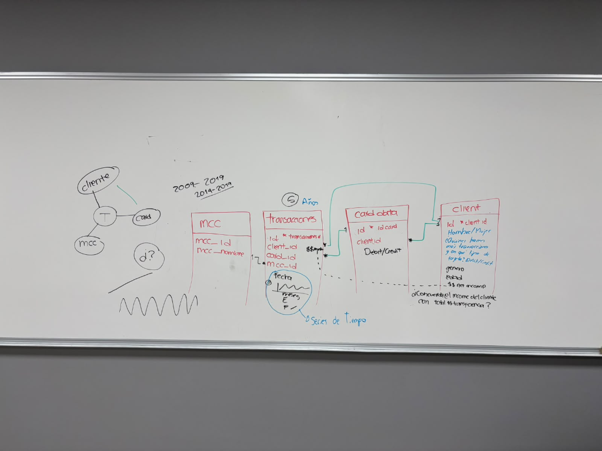

# Modelo Relacional y Relaciones entre Tablas

Este apartado centraliza las relaciones entre las tablas del dataset *Financial Transactions Dataset: Analytics* que el equipo **Lavanderia de Datos** comenzó a diseñar en clase, sirviendo como referencia tanto para quienes cruzan tablas con `pandas.merge()` en Python como para quienes utilizan `JOIN` en SQLite.

---

## 1. Diagrama Entidad-Relación (avance actual)

---

## 2. Resumen de relaciones y llaves de cruce

| Tabla origen (1) | Llave primaria (PK) | Tabla destino (`*` / N) | Llave foránea (FK) | Cardinalidad | Propósito principal del cruce |
| :--- | :--- | :--- | :--- | :---: | :--- |
| `client` (`users_data.csv`) | `id` | `transacciones` (`transactions_data.csv`) | `client_id` | `1 : N` | Asociar cada transacción al perfil demográfico y financiero del cliente (edad, género, ingresos, deuda, score). |
| `client` (`users_data.csv`) | `id` | `card_data` (`cards_data.csv`) | `client_id` | `1 : N` | Vincular a cada cliente con todas sus tarjetas y límites de crédito (clave para la Pregunta 3). |
| `card_data` (`cards_data.csv`) | `id` | `transacciones` (`transactions_data.csv`) | `card_id` | `1 : N` | Identificar qué tipo/marca de tarjeta (`Debit` / `Credit`) se utilizó en cada transacción. |
| `mcc` (`mcc_codes.json`) | `mcc_id` *(clave JSON)* | `transacciones` (`transactions_data.csv`) | `mcc` *(anotado `mcc_id` en el pizarrón)* | `1 : N` | Traducir el código numérico `mcc` al nombre o giro comercial (`mcc_nombre`). |
| `transacciones` (`transactions_data.csv`) | `id` | `train_fraud_labels` (`train_fraud_labels.json`) | `transaction_id` | `1 : 1` | Incorporar la etiqueta de fraude (`Yes` / `No`) para el análisis y modelado de las Preguntas 1 y 2. |

---

## 3. Equivalencia entre el pizarrón y los archivos reales de Kaggle

Para evitar errores de nombres al escribir código en `src/limpieza_datos.py`, `notebooks_preguntas/` o `sql/consultas.sql`, aquí se muestra la correspondencia exacta:

| Nombre en pizarrón | Archivo en `data/raw_data/` | Columnas clave en el archivo original |
| :--- | :--- | :--- |
| `transacciones` | `transactions_data.csv` | `id`, `date`, `client_id`, `card_id`, `mcc`, `amount`, `merchant_id`, `merchant_city`, `merchant_state`, `use_chip`, `errors` |
| `card_data` | `cards_data.csv` | `id`, `client_id`, `card_brand`, `card_type`, `credit_limit`, `has_chip`, `acct_open_date` |
| `client` | `users_data.csv` | `id`, `gender`, `current_age`, `yearly_income`, `per_capita_income`, `total_debt`, `credit_score`, `num_credit_cards` |
| `mcc` | `mcc_codes.json` | Diccionario JSON `{"<mcc_id>": "<mcc_nombre>"}` |
| *(etiquetas de fraude)* | `train_fraud_labels.json` | Diccionario JSON con mapeo `transaction_id -> "Yes" / "No"` |

> **Nota de limpieza importante:** En los archivos originales de Kaggle, las columnas monetarias (`amount`, `credit_limit`, `yearly_income`, `per_capita_income`, `total_debt`) vienen como texto con el símbolo `$` (y posibles comas o signos negativos). Conviene normalizarlas a valores numéricos durante la etapa de limpieza en `src/limpieza_datos.py`.

---

## 4. Notas y líneas de análisis levantadas en el pizarrón

1. **Ventana temporal acotada (5 años):** Se definió recortar el periodo original `2009–2019` hacia los últimos **5 años (`2014–2019`)** para trabajar con un volumen manejable y relevante.
2. **Series de tiempo:** A partir de la columna `date` (`fecha`) de `transacciones`, analizar tendencias mensuales y estacionalidad.
3. **Preguntas exploratorias adicionales del pizarrón:**
   - *¿Quiénes hacen más transacciones (Hombre/Mujer) y con qué tipo de tarjeta (`Debit` / `Credit`)?* (cruce `client` + `card_data` + `transacciones`).
   - *¿Concuerda el ingreso del cliente (`net income` / `yearly_income`) con el total transferido (`amount`)?* (cruce `client` + `transacciones`).

---

## 5. Foto de referencia del pizarrón

---

## 6. Registro de cambios en el modelo relacional

> Por cada cambio que hagan en las relaciones entre tablas, nuevas columnas derivadas o llaves de cruce que añadan, documenten aquí qué cambiaron y por qué decidieron implementar esa solución.

| Fecha | Integrante | Cambio realizado en el modelo | Motivo / justificación |
| :--- | :--- | :--- | :--- |
| Inicial | Lavanderia de Datos | Definición de relaciones base entre `client`, `card_data`, `transacciones` y `mcc`, más ventana temporal `2014–2019`. | Establecer un esquema común para cruzar tablas y responder las preguntas del proyecto. |
